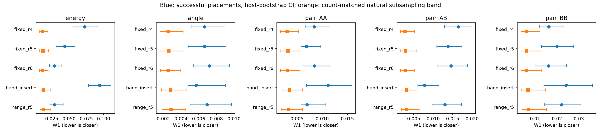
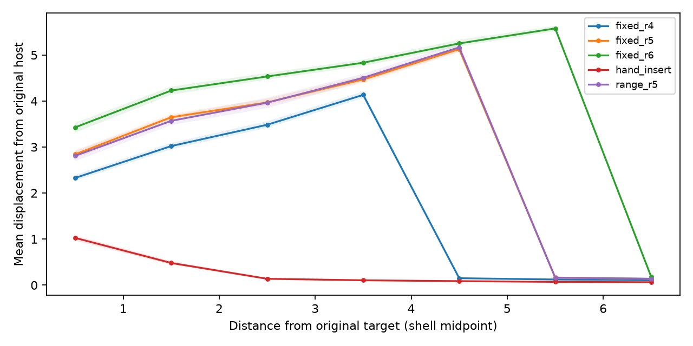
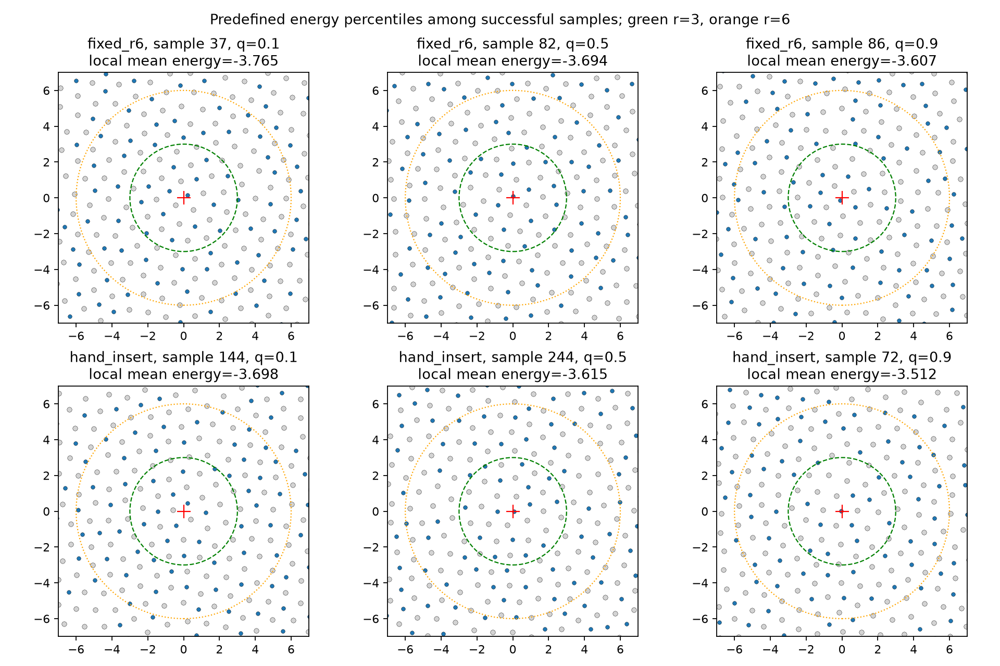
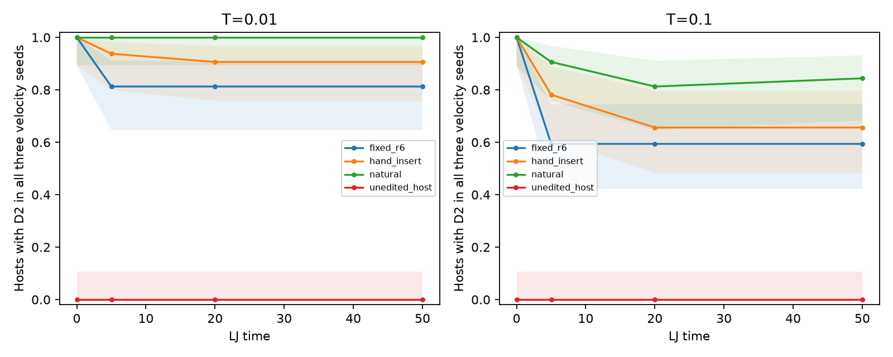

# Physical credibility follow-up

Completed 18 October 2026. This follow-up adds host-aware, sample-count-matched structural comparisons; finite-temperature MD with natural, insertion and unedited controls; original-host displacement; and a small matched repeat across three trained models plus a null-label sham.

**The measurements are complete for the stated protocol, but they do not establish that generated defects are equivalent to natural defects.** The radius-6 D2 setting creates defects more often than hand insertion and improves local energy realism, while retaining larger structural differences, more host displacement, and lower observed short-term defect retention. The new seed/sham evaluation is only eight requests per model and is not a publication-scale replication.

## 1. Successful-only structure with host-aware uncertainty

The natural test reference draws one D2 site per host from 99 test glasses. Bootstrap replicates resample whole host groups on both sides. The natural train comparison repeatedly draws the same number of windows as each successful group from 256 distinct training hosts. Its interval is an empirical subsampling band, not a confidence interval on a universal natural floor. All comparisons use a local radius of 3.

| Method | Successful requests / hosts | Energy W1 [host-bootstrap 95% CI] | Count-matched natural median [subsampling band] |
|---|---:|---:|---:|
| fixed_r4 | 143 / 88 | 0.0728 [0.0558, 0.0918] | 0.0119 [0.0074, 0.0193] |
| fixed_r5 | 122 / 78 | 0.0437 [0.0312, 0.0586] | 0.0123 [0.0076, 0.0200] |
| fixed_r6 | 131 / 89 | 0.0289 [0.0218, 0.0394] | 0.0117 [0.0073, 0.0199] |
| hand_insert | 76 / 58 | 0.0943 [0.0781, 0.1109] | 0.0129 [0.0081, 0.0230] |
| range_r5 | 77 / 62 | 0.0290 [0.0223, 0.0415] | 0.0129 [0.0080, 0.0228] |

`fixed_r4/r5/r6` use the model trained with a fixed radius and sampled at the indicated radius. `range_r5` uses the newly trained variable-radius model. All use guidance 2 and training seed 0. See [protocol](structural_protocol.json) for exact retained run paths.

**Interpretation:** the revised radius-6 energy W1 is 0.0289, compared with 0.0943 for hand insertion and a natural median of 0.0117. The earlier 0.0174 successful-only value used the repository’s ordered/capped multi-site natural reference. These are different reference designs; the new result is a robustness check, not a change to generated samples. The near-natural-energy claim is weaker under the host-balanced reference. Pair-distance and bond-angle mismatches also remain; energy agreement alone is insufficient.



[All five structural descriptors](host_aware_structure.csv). Blue intervals are host-bootstrap CIs; orange intervals describe count-matched natural subsampling variability. Do not treat interval overlap as a formal equivalence test.

## 2. Host disturbance and genuinely new defects

Original hosts were recovered and checked against saved coordinates for model runs. Hand-insertion host indexing was checked against saved original target positions, species and boxes; inserted coordinates were not mistaken for original hosts.

Among successful requests, host-balanced mean displacement in the radius-6–7 shell is **0.180** for `fixed_r6`, versus **0.064** for hand insertion. All atoms are allowed to move during the final relaxation. The energy advantage therefore comes with a larger spatial edit; it is not a guarantee of preserving the outer host.



| Method | Initially non-D2 requests | Newly D2 after relaxation | Creation rate on initially non-D2 sites |
|---|---:|---:|---:|
| fixed_r4 | 238 | 132 | 55.5% |
| fixed_r5 | 238 | 110 | 46.2% |
| fixed_r6 | 238 | 124 | 52.1% |
| hand_insert | 237 | 64 | 27.0% |
| range_r5 | 238 | 71 | 29.8% |

Thus 124 of the 131 successful radius-6 requests create D2 at initially non-D2 sites. This is not merely preservation of pre-existing defects. These are descriptive counts; the conditional creation rates above do not have inferential intervals attached.

[Per-request host/creation outcomes](host_creation_outcomes.csv), [displacement table](host_disturbance.csv).

### Predefined structure inspection

The six structures below are selected at the 10th, 50th and 90th percentiles of local mean energy among successful requests, separately for the radius-6 model and hand insertion. This is a fixed numerical selection rule, not visual selection of appealing samples. Low energy is not asserted to mean natural structure.



[Exact sample indices and selection values](representative_selection.csv).

## 3. Finite-temperature defect retention

Four cohorts each contain 32 distinct host glasses. Generated and insertion cohorts are selected from successful relaxed placements, selecting a host before one successful request within that host. The unedited cohort uses the original hosts and sites paired with the generated cohort. Natural sites are sampled from distinct test hosts.

The repository KA potential is used in whole-box free NVT dynamics, dt=0.005 and thermostat damping 0.1. T=0.01 is the dataset final temperature; T=0.1 is a 10x-temperature stress test. Each structure has three velocity realizations, giving 768 trajectories. Observations are at 0, 5, 20 and 50 LJ time units. Snapshot minimization is performed in a separate engine and never changes the running trajectory.

### D2 identity at time 50, after independently minimizing the snapshot

| Cohort | T=0.01: occupied / 96 trajectories | T=0.1: occupied / 96 trajectories |
|---|---:|---:|
| fixed_r6 | 80/96 (83.3%) | 70/96 (72.9%) |
| hand_insert | 90/96 (93.8%) | 77/96 (80.2%) |
| natural | 96/96 (100.0%) | 84/96 (87.5%) |
| unedited_host | 0/96 (0.0%) | 1/96 (1.0%) |

All generated, insertion and natural targets are D2 after time-zero minimization. All paired unedited targets are non-D2 at time zero; their later values are spontaneous occupancy, not retention of a defect that was initially present.

**The 96 trajectories are not independent host samples.** The figure instead shows the proportion of 32 hosts with D2 in all three velocity realizations at each observation, with Wilson intervals. For example, at T=0.01 the endpoint counts are 26/32 generated hosts, 29/32 insertion hosts and 32/32 natural hosts. A 32/32 observation still has a Wilson lower bound around 0.893; it does not demonstrate perfect population retention.



**Interpretation:** many generated D2 defects persist over this short test, but observed retention is lower than natural controls and successful hand insertions. This does not justify calling them uniformly stable or naturally equivalent. The observations measure threshold-defined defect occupancy, not continuous defect lifetime, barrier heights, or long-term material performance. We do not assert a statistically significant between-method difference from these point estimates alone.

[Full retention table](md_retention.csv) also separates thermal classification, quenched same-atom classification, and same-atom D2 within 0.5 of the original site. [Protocol](md_protocol.json), [cohort coordinates and source indices](md_cohorts.npz), and [per-trajectory observations](md_trajectories/) are retained.

### Numerical checks

All 3,072 snapshots meet force tolerance 1e-6. Initial LAMMPS/PyTorch total energies agree within 2.85e-12. Eleven CG snapshots required the repository FIRE minimizer to polish a residual above tolerance; the maximum refinement was 818 steps. Force checks were not weakened. LAMMPS residuals are largest Cartesian components; FIRE-polish residuals are per-atom norms, which also bound the components. Completed CG snapshots already below tolerance were reused.

A diagnostic subset of 112 observations from accepted initial FIRE runs differs from the final CG-based classification in one case. This indicates some minimizer sensitivity and is not a systematic equivalence study. See [validation](validation.json), [comparison](minimizer_sensitivity.csv), and [accepted diagnostic FIRE trajectories and protocol](minimizer_pilot_fire/).

## 4. Matched three-model and sham pilot

Each model receives the same eight original hosts, targets, pins, initial-noise rule and sampling-noise rule. The seed-0 sham replaces the class token with NULL; setting guidance to zero while retaining the defect label would not be a sham. Sampling uses 100 noisy plus 100 final steps and radius 6. Guided runs use w=2. All 32 outputs converge during whole-box relaxation.

| Model | Successful / 8 | Success [95% Wilson interval] | Mean displacement outside radius 6 |
|---|---:|---:|---:|
| seed0 | 2/8 | 25.0% [7.1%, 59.1%] | 0.168 |
| seed1 | 2/8 | 25.0% [7.1%, 59.1%] | 0.171 |
| seed2 | 4/8 | 50.0% [21.5%, 78.5%] | 0.142 |
| sham_seed0 | 0/8 | 0.0% [0.0%, 32.4%] | 0.187 |

**This is an eight-request pilot, not journal-strength replication.** The intervals are wide and the model point estimates do not replace the earlier 256-request evaluations. Zero sham successes does not establish a zero underlying success rate (its upper Wilson bound is about 32%). The sham also displaces the outer host, so disturbance is not exclusive to successful defect placement. These small counts do not establish causal attribution or a precise across-training-seed spread.

[Repeat summary](repeat_summary.csv), [raw repeat data and batch checkpoints](repeats/).

## Reproduce or extend

From the repository root with the project dev/MD extras installed:

```bash
python scripts/check_physical_credibility.py structural --out runs/credibility_check --bootstrap 500
export LD_LIBRARY_PATH="$(python -c 'import sys; print(sys.prefix)')/lib${LD_LIBRARY_PATH:+:$LD_LIBRARY_PATH}"
python scripts/check_physical_credibility.py md --out runs/credibility_check --workers 2
python scripts/repeat_credibility.py --out runs/credibility_check/repeats --n 8 --workers 4 --batch-size 2
python scripts/plot_credibility_followup.py --out runs/credibility_check
```

For a larger GPU repeat, use a new output directory:

```bash
python scripts/repeat_credibility.py --out runs/credibility_repeat_full \
  --n 256 --workers 1 --batch-size 64 --device cuda
```

Complete protocol: [docs/PHYSICAL_CREDIBILITY.md](../../docs/PHYSICAL_CREDIBILITY.md). Source revision for this report: `dcff813b84f9817468e82eb31b766e0dee29748c`. [Manifest](manifest.json) hashes source data, models, scripts, and generated result files. Diagnostic FIRE pilot records and their protocol are retained for audit; they include only accepted pilot trajectories. The main MD protocol is reproducible from the retained cohorts and seeds.

## What is and is not resolved

- Completed: successful-only physical descriptors, a host-aware/count-matched reference check, original-host disturbance, new-creation accounting, predefined structure inspection, matched short-term thermal controls, and a small three-model/null-label pilot.
- Still needed for journal-strength claims: the larger 256-request matched repeat; robustness across additional independent host/cohort selections and longer stability horizons; and an improved model or narrower claim addressing the observed structural mismatch and retention loss. D1− is not thermally validated by this D2-focused follow-up.
- The finite-temperature test was limited to the primary seed-0 radius-6 setting. Do not extend its retention rates to every trained model, defect class, temperature, or timescale.

Suggested claim: **the tested model creates D2 defects more frequently than hand insertion, with lower local energy mismatch and substantial short-term retention, but with broader host changes and defect environments that remain measurably different from natural controls.**
