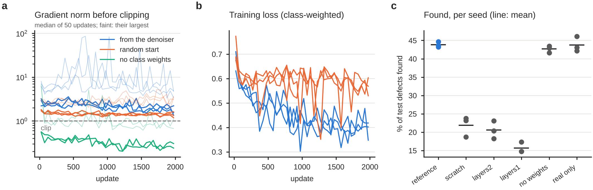

# Seed study of the point-defect finder: is the EGNN stable?

Prof. Dabo pointed out that EGNNs can be unstable. Two questions are tested:

1. **Does training misbehave?** Every update was logged (`*.steps.csv`): the loss and the
   gradient norm *before* clipping (training clips at 1.0, which otherwise hides a large
   gradient). A spike is a gradient more than 5 times the median of the previous 100 updates,
   or a loss more than 3 times the median of the previous 50 updates of the same batch type
   (each batch holds one defect type or no defect, so the loss differs between batch types by
   design).
2. **Do the results depend on the seed?** The six 2,000-update runs of the ablation table
   (`../point_defects_ablations_20261112/`, seed 0) were repeated with seeds 1 and 2, and every
   run was scored on the same 750 real test defects (calibrated, trained weights).

Training on CPU is reproducible: the logged reruns of seed 0 (`reference_s0`, `scratch_s0`)
have exactly the weights of the published seed-0 runs.



## 1. The results hardly depend on the seed

Defects found, mean over seeds 0, 1 and 2, with the spread between seeds (sd):

| Variant (2,000 updates) | Vacancy | Interstitial | Frenkel pair | Antisite | **All** |
|---|---|---|---|---|---|
| Reference: starts from the denoiser, 4 layers, class weights | 63.0 ± 0.9 | 30.7 ± 1.0 | 38.7 ± 3.7 | 41.7 ± 1.0 | **43.8 ± 0.8** |
| Random starting weights | 14.3 ± 2.8 | 26.8 ± 0.8 | 22.2 ± 2.5 | 24.2 ± 5.4 | **21.9 ± 2.8** |
| Random start, 2 layers | 13.8 ± 1.5 | 26.5 ± 1.0 | 21.3 ± 3.1 | 20.8 ± 4.2 | **20.6 ± 2.4** |
| Random start, 1 layer | 12.3 ± 1.0 | 21.8 ± 1.0 | 13.8 ± 3.1 | 14.2 ± 1.3 | **15.6 ± 1.5** |
| No class weights | 63.2 ± 2.0 | 31.0 ± 0.5 | 35.1 ± 3.9 | 39.5 ± 1.3 | **42.7 ± 1.0** |
| Without the Frenkel pairs that are no defects | 64.7 ± 2.1 | 30.8 ± 1.1 | 38.0 ± 3.1 | 40.2 ± 2.9 | **43.8 ± 2.1** |

- **The current finder is consistent:** all three seeds find 43.2-44.7% of the defects; no
  seed is better than another on the same defects (McNemar p = 0.20-0.80). They agree on 88%
  of the defects (found by all three: 37.7%, by none: 50.1%). The three averaged find 45.1%.
- **The ablation table holds up, with one correction:**
  - starting from the denoiser: +22 points, in every seed;
  - 1 layer instead of 4: 6.2 points fewer (random start; lower in every seed); 2 layers: 1.3
    fewer, within the spread;
  - no class weights: 1.2 points fewer, lower in all three seeds but not significant in any
    one (a small effect at most);
  - training without the Frenkel pairs that are no defects: **no difference** (43.8 against
    43.8). The 2.6-point loss of the single seed-0 run in the ablation table was seed noise.

## 2. Training: spikes, contained by clipping

| Variant (2,000 updates, seeds) | Gradient norm, median | Largest | Updates clipped | Gradient spikes | Loss spikes | Not finite |
|---|---|---|---|---|---|---|
| From the denoiser (0, 1, 2) | 2.0-2.5 | 38-86 | 95-96% | 9-32 | 1-13 | 0 |
| Without the faulty Frenkel pairs (1, 2) | 1.9-2.5 | 26-72 | 93-96% | 7-21 | 4-17 | 0 |
| No class weights (1, 2) | 0.31-0.34 | 6.2-6.7 | 1-3% | 3-4 | 5-11 | 0 |
| Random start, 4, 2 or 1 layers (0, 1, 2) | 1.4-1.5 | 3.6-5.2 | 87-93% | 0 | 0 | 0 |

- **No run diverged:** no loss or gradient was ever not a finite number, and the loss falls
  steadily in every run.
- **The finder from the denoiser has gradient spikes** up to about 40 times its usual size, often a
  few updates in a row. Clipping limits each update, and the found rate does not depend on how
  spiky a seed was (seed 2 had the most spikes and the largest, 86, and finds 43.6%).
- **The class weights set the scale.** They multiply the loss of the rare defect atoms by 9 to
  32, so the gradient sits around 2 and is clipped in 95% of updates; without them it is about
  0.3 and almost never clipped.
- **Random starts are smooth over 2,000 updates**, but this is too early to tell. The
  20,000-update GPU runs of the EGNN from random weights in
  `../kaggle_arch_20261115-0247Z/` (seeds 0, 1, 2) are smooth for the first 8,000-10,000
  updates (first spike at update 7,818, 8,641 and 9,704); then they pass through a phase of
  frequent spikes (71, 131 and 96 in all; largest 55-82) that eases towards the end. Their loss keeps
  falling throughout and the three seeds find 42.9-43.9%.
- **The transformer and the CNN trained the same way have no spike at all** in 20,000
  updates (largest gradient 4.9-5.5 and 6.3-8.1), and find 53.6% and 54.0%
  (`../point_defects_architectures_20261115/README.md`).

**Answer to the question.** The EGNN finder trains with recurring gradient spikes, both from
the denoiser and, after some thousands of updates, from random weights. Gradient clipping
contains them: no run diverged, and the result varies by less than one point between seeds.
A transformer and a CNN trained the same way have none, and find more.

## Files

- `seeds.json`, `summary.md`: every number above, per run and per variant
  (`scripts/pilots/finder_seeds.py`).
- `stability.png`, `stability.pdf`: the figure.
- `<variant>_s<seed>.steps.csv`: one row per update (defect type, defect-free or not, loss,
  gradient norm before clipping); `.log.jsonl`: training log; `.config.yaml`: settings;
  `.pt`: trained weights (seeds 1 and 2; seed 0 is in `../point_defects_ablations_20261112/`).
- `seeds.log`: when each run started. The run folders (`runs/`) are not kept.

To reproduce (about 11 hours on 4 CPU cores; a run that is interrupted continues from its last
checkpoint):

```bash
bash scripts/pilots/finder_seeds.sh
python scripts/pilots/finder_seeds.py
```
