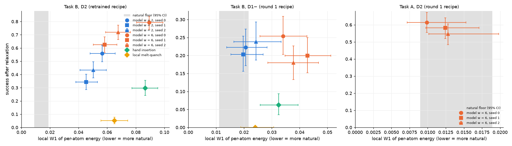

# Training seeds: how much do the headline results change between training runs?

Until now every headline number came from one training run per model (seed 0). Here both
conditional recipes were trained twice more (seeds 1 and 2), and the five headline rows were
repeated with each new model:
- round 1 recipe (noise σ ≤ 0.5), used for D1− and Task A;
- retrained recipe (σ ≤ 1.0), used for D2.

The recipe is identical to seed 0 (checked against the round 1 config); only the seed changes.

- **Same evaluation draw.** All rows use sampler seed 0, so every model sees the same hosts,
  sites and noise, and differences between seeds come from training alone.
- **New-draw check.** The seed-0 models were also re-sampled once with sampler seed 1 (new
  hosts, sites and noise). This shows how much a result moves when only the evaluation draw
  changes.

**Data:** `notebooks/kaggle_seeds.ipynb`, one Kaggle session (T4 x2). Results were pushed to
`results/kaggle_20261013-*`:
- the models are under `training/egnn_cond{,_smax1}_seed{1,2}/`;
- the experiments are named `seed1_*`, `seed2_*` and `sampseed1_*`.

All four new models trained for the full 50,000 updates. Their validation losses agree with
seed 0's to within a few percent at every noise level (within 2% at σ = 0.1). The figure is made by `scripts/plot_seeds.py`.

## 1. Results

Success after relaxation, with 95% bootstrap CIs in the per-seed columns:

| Row | Seed 0 | Seed 1 | Seed 2 | **Mean ± sd** | Seed 0, new draw |
|---|---|---|---|---|---|
| Task B D2, retrained, w = 2 | 0.56 [0.50, 0.62] | 0.34 [0.29, 0.40] | 0.43 [0.38, 0.50] | **0.45 ± 0.11** | 0.55 |
| Task B D2, retrained, w = 6 | 0.79 [0.74, 0.84] | 0.62 [0.57, 0.68] | 0.72 [0.66, 0.77] | **0.71 ± 0.08** | 0.84 |
| Task B D1−, round 1, w = 2 | 0.22 [0.17, 0.27] | 0.20 [0.16, 0.25] | 0.24 [0.19, 0.29] | **0.22 ± 0.02** | 0.17 |
| Task B D1−, round 1, w = 6 | 0.25 [0.20, 0.31] | 0.20 [0.15, 0.25] | 0.18 [0.13, 0.23] | **0.21 ± 0.04** | 0.27 |
| Task A D2, round 1, w = 6 | 0.61 [0.55, 0.67] | 0.58 [0.52, 0.64] | 0.55 [0.48, 0.61] | **0.58 ± 0.03** | 0.61 |

Local W1 of the per-atom energy (lower is more natural; natural floor D2 0.013, D1− 0.016):

| Row | Seed 0 | Seed 1 | Seed 2 | **Mean ± sd** | Hand insertion |
|---|---|---|---|---|---|
| Task B D2, w = 2 | 0.056 | 0.045 | 0.050 | **0.051 ± 0.006** | 0.087 |
| Task B D2, w = 6 | 0.089 | 0.058 | 0.068 | **0.072 ± 0.016** | 0.087 |
| Task B D1−, w = 2 | 0.021 | 0.020 | 0.024 | **0.022 ± 0.002** | 0.032 |
| Task B D1−, w = 6 | 0.034 | 0.043 | 0.038 | **0.038 ± 0.004** | 0.032 |
| Task A D2, w = 6 | 0.010 | 0.012 | 0.013 | **0.012 ± 0.002** | — |

Baselines (no training seed; their 95% CIs cover the evaluation draw):
- hand insertion: D2 0.30 [0.24, 0.36], D1− 0.06 [0.04, 0.09];
- local melt-quench: D2 0.05, D1− 0.00.

## 2. What this says

1. **The evaluation draw matters little.** Re-sampling the seed-0 models with new hosts,
   sites and noise moved success by 0.023 on average (at most 0.05). That is within the
   bootstrap CIs we report (half-width about 0.05–0.06), so the CIs describe the evaluation
   noise well.
2. **D1− and Task A are stable across training runs.** Their spread between seeds (sd
   0.02–0.04) is no larger than the evaluation noise.
3. **Task B D2 with the retrained recipe is not stable.** Its spread (sd 0.08–0.11) is about
   twice the bootstrap half-width. Seed 0, the model behind every earlier D2 number, was the
   most successful of the three at both guidance weights.
4. **The seeds differ in how strongly they follow the label, not in how well they denoise.**
   - For both guidance weights the seeds rank the same in success and in local W1: seed 1
     lowest in both, seed 0 highest in both. They lie on the same success-versus-realism
     line that the guidance weight traces (figure, left panel).
   - The share of samples with the defect in place before relaxation also varies (w = 2:
     0.41, 0.69, 0.86).
   - Validation losses agree to within a few percent (2% at σ = 0.1).
   - So each training run ends with a different effective guidance strength. The denoising
     loss cannot see this; it is another case of "lower loss does not mean better samples"
     (round 3).
5. **The method still beats both baselines for every seed**, with one exception:
   - **D2, w = 6:** 2.1–2.7× hand insertion's success (mean 2.4×), with surroundings as
     natural or more natural (W1 0.058–0.089 vs 0.087). Every seed's CI lies above hand
     insertion's.
   - **D2, w = 2:** 1.2–1.9× (mean 1.5×), with clearly more natural surroundings for every
     seed (0.045–0.056 vs 0.087). Seed 1's success CI [0.29, 0.40] overlaps hand
     insertion's [0.24, 0.36]; seeds 0 and 2 are clearly above.
   - **D1−, w = 2:** 3.3–3.8× (mean 3.5×), with surroundings 1.2–1.5× the natural floor
     and more natural than hand insertion for every seed.
   - **D1−, w = 6:** 2.9–4.1× (mean 3.4×), with surroundings slightly less natural than
     hand insertion (0.038 vs 0.032).
   - **Task A, D2:** 0.55–0.61 success with surroundings at the natural floor for every seed.
   - **Local melt-quench** stays at or below 0.05 everywhere.

## 3. What changes in the report

**Headline numbers become means over three training runs:**
- **Task B D2:**
  - 0.71 ± 0.08 at w = 6 (2.4× hand insertion), with surroundings as natural or more natural;
  - 0.45 ± 0.11 at w = 2 (1.5×), with clearly more natural surroundings.

  The earlier "1.9–2.6×" came from seed 0 alone and should not be quoted.
- **Task B D1−:** 0.22 ± 0.02 at w = 2 (3.5×), close to the natural floor.
- **Task A D2:** 0.58 ± 0.03, at the natural floor.

**Other changes:**
- Show the per-seed scatter (this figure) next to the main table, and state the seed spread
  as a result: a training run fixes an effective guidance strength.
- Choosing the guidance weight per trained model on validation data (for a target realism or
  success rate) should shrink the D2 spread. This is cheap and the obvious next step if the
  D2 numbers need to be tighter.
- The sensitivity checks (`results/sensitivity/`) used the seed-0 models. Their conclusions
  are about the evaluation settings and the ranking of methods, which every seed preserves,
  so they stand.

**Limits:** three seeds give a rough estimate of the spread. The D1+ class and the symmetry
ladder (Stage 4) were not repeated over seeds.
