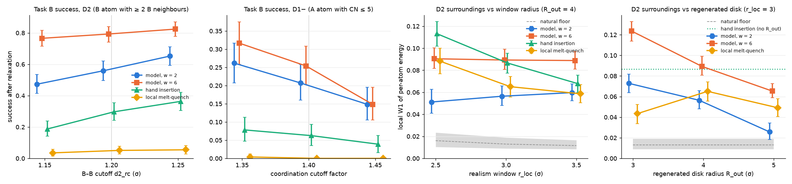

# Sensitivity checks: do the headline results depend on our evaluation settings?

**What was varied**, one setting at a time, with everything else at its frozen value:

| Setting | Frozen | Tested | What it controls |
|---|---|---|---|
| Defect cutoff, D2 (`d2_rc`) | 1.20σ | 1.15, 1.25 | a B atom with ≥ 2 B neighbours closer than this is a D2 defect |
| Defect cutoff, D1− (`cn_factor`) | 1.40 | 1.35, 1.45 | coordination cutoff = factor × σ_ab (A–A cutoff moves by ±0.05σ) |
| Success radius (`r_tol`) | 0.5σ | 0.4, 0.6 | how close the defect atom must be to the requested site |
| Realism window (`r_loc`) | 3.0σ | 2.5, 3.5 | radius of the window whose energies are compared with natural defects |
| Regenerated disk (`R_out`) | 4σ | 3, 5 | Task B: the model (and local melt-quench) rebuilds this disk around the site |

The natural reference defects are relabelled with the same shifted cutoffs, so the success
test and the reference always use one definition. The natural-vs-natural floor is
recomputed for every setting (`floor_D2.json`, `floor_D1_MINUS.json`).

**Data:** `notebooks/kaggle_sensitivity.ipynb` (one Kaggle session, 21 experiments, pushed
to `results/kaggle_20261012-2211Z` … `kaggle_20261013-0212Z`, names starting with `sens_`).
The first four settings only change the scoring, so `scripts/sensitivity.py` re-scores
the same 256 relaxed samples per row (`sensitivity.json` next to each `metrics.json`).
R_out changes the generation, so it has its own samples. The full table is `summary.md` /
`summary.csv`; the figure is made by `scripts/plot_sensitivity.py`.

## 0. Reproducibility

The nine rows at the frozen settings were sampled again with round 3's seed. Eight of the
nine repeat the earlier numbers to the last digit. The ninth (round 1 model, w = 2, D1−)
differs within its confidence interval: success 0.21 vs 0.22, local W1 0.016 vs 0.021.

## 1. Defect cutoff ±0.05

Task B success after relaxation (95% CI), with the model's success as a multiple of hand
insertion's:

**D2** (B–B cutoff)

| Method | 1.15 | **1.20 (frozen)** | 1.25 |
|---|---|---|---|
| Retrained model, w = 2 | 0.47 [0.41, 0.54] (2.5×) | 0.56 [0.50, 0.62] (1.9×) | 0.65 [0.59, 0.71] (1.8×) |
| Retrained model, w = 6 | 0.77 [0.71, 0.82] (4.1×) | 0.79 [0.74, 0.84] (2.7×) | 0.82 [0.78, 0.87] (2.3×) |
| Hand insertion | 0.19 [0.14, 0.24] | 0.30 [0.24, 0.36] | 0.36 [0.30, 0.42] |
| Local melt-quench | 0.04 [0.02, 0.06] | 0.05 [0.03, 0.08] | 0.05 [0.03, 0.08] |

**D1−** (coordination cutoff factor)

| Method | 1.35 | **1.40 (frozen)** | 1.45 |
|---|---|---|---|
| Round 1 model, w = 2 | 0.26 [0.21, 0.32] (3.4×) | 0.21 [0.16, 0.26] (3.3×) | 0.15 [0.11, 0.20] (3.8×) |
| Round 1 model, w = 6 | 0.32 [0.26, 0.38] (4.0×) | 0.25 [0.20, 0.31] (4.1×) | 0.15 [0.11, 0.20] (3.8×) |
| Hand insertion | 0.08 [0.05, 0.11] | 0.06 [0.04, 0.09] | 0.04 [0.02, 0.06] |
| Local melt-quench | 0.00 [0.00, 0.01] | 0.00 [0.00, 0.00] | 0.00 [0.00, 0.00] |

- **The ranking never changes.** At every cutoff the model's CI lies above hand insertion's,
  and local melt-quench stays near zero. The model succeeds 1.8–4.1× as often as hand
  insertion for D2 and 3.3–4.1× for D1−.
- **The absolute rates move with the definition**, by up to about 0.1 in either direction
  (up to 40% of the rate for D1−). A looser definition gives more successes for every method.
  Success rates must always be quoted with the definition they use.
- The retrained model at w = 6 is the least sensitive for D2 (0.77–0.82): its B–B pairs sit
  well inside the cutoff, not at its edge.
- Task A (round 1 model, w = 6, D2) moves from 0.54 to 0.61 to 0.71, with surroundings at or
  near the floor at every cutoff (local W1 0.009 / 0.010 / 0.014 against floors 0.014 / 0.013
  / 0.009).

## 2. Success radius ±0.1

| Method | 0.4 | **0.5 (frozen)** | 0.6 |
|---|---|---|---|
| D2, retrained model w = 2 | 0.49 | 0.56 | 0.59 |
| D2, retrained model w = 6 | 0.70 | 0.79 | 0.86 |
| D2, hand insertion | 0.28 | 0.30 | 0.30 |
| D1−, round 1 model w = 2 | 0.18 | 0.21 | 0.22 |
| D1−, round 1 model w = 6 | 0.21 | 0.25 | 0.27 |
| D1−, hand insertion | 0.05 | 0.06 | 0.07 |

Hand insertion hardly moves: it puts the patch exactly on the site. For 10–16% of the
model's D2 samples the defect atom lies 0.4–0.6σ from the site, so its success depends more
on the radius (w = 6: 0.70 to 0.86). The ranking holds at the strictest radius: at 0.4, the model still has 1.7–2.5× the
success of hand insertion for D2.

## 3. Realism window ±0.5

Local W1 of the per-atom energy (lower is more natural):

| Method | r_loc 2.5 | **3.0 (frozen)** | 3.5 |
|---|---|---|---|
| **D2**: retrained model w = 2 | **0.051** | **0.056** | 0.060 |
| D2: retrained model w = 6 | 0.090 | 0.089 | 0.089 |
| D2: hand insertion | 0.113 | 0.087 | 0.068 |
| D2: local melt-quench | 0.088 | 0.065 | 0.059 |
| D2: natural floor | 0.016 | 0.013 | 0.012 |
| **D1−**: round 1 model w = 2 | **0.019** | **0.016** | **0.014** |
| D1−: round 1 model w = 6 | 0.053 | 0.034 | 0.029 |
| D1−: hand insertion | 0.042 | 0.032 | 0.025 |
| D1−: natural floor | 0.016 | 0.016 | 0.011 |

- **Hand insertion's damage is local:** its W1 falls from 0.113 to 0.068 as the window grows
  and takes in more untouched host. **The model's is spread over the whole regenerated
  disk:** at w = 6 its W1 is flat (0.089–0.090).
- So the round 3 statement "the retrained model at w = 6 has surroundings as natural as hand
  insertion" holds only at r_loc = 3. Within 2.5σ the model is more natural (0.090 vs
  0.113); within 3.5σ it is less natural (0.089 vs 0.068).
- At w = 2 the D2 model is more natural than hand insertion at 2.5 and 3.0. At 3.5 the CIs
  overlap (0.060 [0.052, 0.068] vs 0.068 [0.060, 0.076]).
- The D1− model at w = 2 stays within 1.0–1.3× of the floor at every window. It is more
  natural than hand insertion at each window (CIs separate at 2.5 and 3.0, touching at 3.5).

The defect cutoff barely changes local W1 for D2 (all methods within ±0.005). For D1− it
matters for the model: with the looser cutoff 1.35, the w = 2 model's W1 rises to 0.028
(floor 0.014), and its advantage over hand insertion (0.037) is no longer significant. The
round 3 claim **"D1− surroundings at the natural floor" holds at the frozen cutoff and at
1.45 (1.6× the floor), not at 1.35 (2× the floor).**

## 4. Size of the regenerated disk (R_out)

The model was trained with R_out = 4 only.

| Method | R_out 3 | **4 (frozen)** | 5 |
|---|---|---|---|
| D2, retrained w = 2: success | 0.54 | 0.56 | 0.48 |
| D2, retrained w = 2: local W1 | 0.073 | 0.056 | **0.026** |
| D2, retrained w = 6: success | 0.81 | 0.79 | 0.82 |
| D2, retrained w = 6: local W1 | 0.124 | 0.089 | 0.065 |
| D1−, round 1 w = 2: success / W1 | 0.18 / 0.020 | 0.21 / 0.016 | 0.19 / 0.020 |
| D1−, round 1 w = 6: success / W1 | 0.20 / 0.032 | 0.25 / 0.034 | 0.20 / 0.032 |
| D2, local melt-quench: success / W1 | 0.05 / 0.043 | 0.05 / 0.065 | 0.04 / 0.049 |
| D1−, local melt-quench: success / W1 | 0.01 / 0.045 | 0.00 / 0.024 | 0.02 / 0.032 |

- **Success changes little with R_out**: every change is within the CIs (the largest is D2,
  w = 2: 0.56 at R_out 4, 0.48 at 5). The model generalises to disk sizes it was not trained
  on, and local melt-quench fails at every size, so its failure is not an artefact
  of our choice of 4.
- **D2 realism improves strongly with a larger disk:** at R_out = 5, the w = 2 model has
  local W1 0.026, twice the floor, against 0.087 for hand insertion, with success 0.48
  [0.42, 0.54] (hand insertion 0.30).
- A likely reason, not yet tested: the seam between regenerated and pinned atoms lies at
  R_out. With R_out = 3 it falls inside the r_loc = 3 window; with R_out = 5 it is 2σ
  outside. A larger disk may move the seam out of view rather than remove it.
  - To test this, re-score the R_out runs at several r_loc, or measure W1 in a ring around
    R_out. This needs the samples again; the S2 runs were not kept for re-scoring.
- D1− shows no such trend; its W1 is flat in R_out.

## 5. What this changes in the report

1. **Keep:** the method ranking. The model beats hand insertion and local melt-quench on
   Task B success for D2 and D1− under every setting tested, and the results repeat with the
   same seed (8 of 9 rows to the last digit).
2. **Qualify:** absolute success rates. They move by up to ±0.1 with the defect cutoff and
   the success radius, so quote the definition and, where space allows, this range.
3. **Qualify:** realism comparisons with hand insertion depend on the window. Hand insertion
   damages a small region; the model regenerates a larger one. Report local W1 at two window
   sizes (e.g. 2.5 and 3.5), or as a function of distance.
4. **Soften:** "D1− surroundings at the natural floor" becomes "within 1–2× of the floor,
   depending on the cutoff".
5. **New finding:** R_out = 5 gives D2 surroundings much closer to natural (W1 0.026, 2× the
   floor) at a similar success rate. It needs the seam check in §4 before it becomes a
   claim.

Not covered: the D1+ class (every method fails there). These checks use the seed-0 models;
the training-seed study ([`../seeds/README.md`](../seeds/README.md)) shows that every seed
keeps the method ranking, so the conclusions above stand, but D2 success rates should be
quoted as means over seeds.
