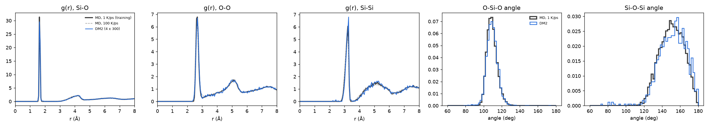

# Stage 0b: DM2's pretrained a-SiO₂ model against its training glasses

**Question:** does DM2's published unconditional model (`gen-a-sio2-uncond-v1.pt`) make
amorphous silica that looks like the glasses it was trained on? This checks that we can
run DM2's model and its sampler, before relying on that sampler for our 2D work.

**Setup:** DM2's unconditional demo, unchanged:
- start from its random 300-atom SiO₂ box (16.8 Å, 2.10 g/cm³);
- 2,900 noisy steps (σ from 1.0 down to 0.001), then 100 noise-free steps.

Four samples (seeds 0–3) on CPU, one thread each: 16.5–18.7 min per sample. DM2 pins torch 2.5
and a GPU; with torch 2.14 on CPU, two loading fixes in `scripts/stage0_dm2_sanity.py` were
enough (see its `_patch_torch_for_dm2`).

**Reference:** the model's training data, the 1 K/ps melt-quenched glasses (samples 0–2, 3,000
atoms each), plus DM2's other simulated glasses at 0.1, 10 and 100 K/ps.

**Reproduce:**

```bash
python scripts/stage0_dm2_sanity.py generate --dm2 DM2 --seed 0 --out runs/stage0/gen_seed0.extxyz
python scripts/stage0_dm2_sanity.py analyze --dm2 DM2 --out results/stage0 runs/stage0/gen_seed*.extxyz
```

Files: `metrics.json` (all numbers), `stage0_dm2_sio2.png` (figure), `samples/` (the four
generated structures).



## 1. Local structure: correct silica

| | DM2 generated | MD 1 K/ps (training) | MD 100 K/ps | Random start |
|---|---|---|---|---|
| Si with 4 O neighbours | 99.3% | 99.9% | 99.7% | 5% |
| O with 2 Si neighbours | 98.4% | 99.6% | 98.1% | 14% |
| Mean Si–O bond (Å) | 1.650 | 1.646 | 1.647 | 1.702 |
| O–Si–O angle (mean ± sd) | 109.4° ± 6.4° | 109.4° ± 5.6° | 109.4° ± 6.6° | 91° ± 38° |
| Si–O–Si angle (mean ± sd) | 151.5° ± 15.2° | 150.7° ± 13.1° | 148.2° ± 14.3° | 88° ± 36° |
| Edge-sharing Si–Si pairs per Si (< 2.8 Å) | 0.0125 (5 pairs) | 0.0020 | 0.0083 | 1.07 |

From random positions the model builds a network of corner-sharing SiO₄ tetrahedra with the
right bond length and tetrahedral angle. All peaks of the three partial g(r) sit at the
training positions with the training heights (figure).

## 2. Distance to the training glasses: like a faster quench

L1 distance of each partial g(r) to the training glasses, up to 8 Å. The generated set has
only 1,200 atoms, so each MD set is cut down to the same number of centre atoms (400 Si,
800 O, drawn at random 50 times). Shown as the mean, with the 95th percentile in brackets.

| | Si–O | O–O | Si–Si |
|---|---|---|---|
| **DM2 generated** | **0.58** | **0.45** | **0.62** |
| MD 1 K/ps, held-out samples 3–5 (floor) | 0.31 (0.39) | 0.23 (0.26) | 0.39 (0.44) |
| MD 0.1 K/ps | 0.34 (0.41) | 0.26 (0.30) | 0.41 (0.46) |
| MD 10 K/ps | 0.37 (0.47) | 0.28 (0.31) | 0.42 (0.48) |
| MD 100 K/ps | 0.50 (0.58) | 0.40 (0.45) | 0.61 (0.68) |
| Random start | 6.20 | 5.41 | 5.91 |

- The model closes about 95% of the gap between the random start and the floor.
- The remaining distance lies above the floor's 95th percentile for all three pairs, and about
  equal to a glass quenched 100× faster than the training data.
- The local-order numbers in §1 say the same:
  - The spread of the tetrahedral angle (6.4°), the share of 2-fold O (98.4%) and the
    edge-sharing tetrahedra (5 pairs where the training rate predicts under 1) all match the
    100 K/ps glasses or go beyond them.
  - Edge-sharing also shows as the small Si–O–Si tail at 80–110° and the faint Si–Si
    shoulder near 2.5 Å in the figure.

## 3. Verdict for the exit criterion

**Passed, with a caveat.** DM2's pretrained model, run with its own demo settings, makes
a-SiO₂ whose g(r) and local structure match the training glasses. On a finer scale it is
more disordered than the 1 K/ps training data, about like a 100 K/ps quench.

Possible causes, not tested here:
1. The 300-atom box is much smaller than the 3,000-atom training glasses, and its density
   is 1.4% lower.
2. No relaxation after sampling.
3. The model was trained with noise up to σ = 0.75 Å, but its sampler starts at σ = 1.0.
   We found and fixed the same mismatch in our 2D model in round 3.

For our project, this is the same pattern as in 2D: the sampler's output does not sit
exactly at the training data's cooling rate. Reports should state which cooling rate the
generated structures resemble, rather than assume it is the training one.
