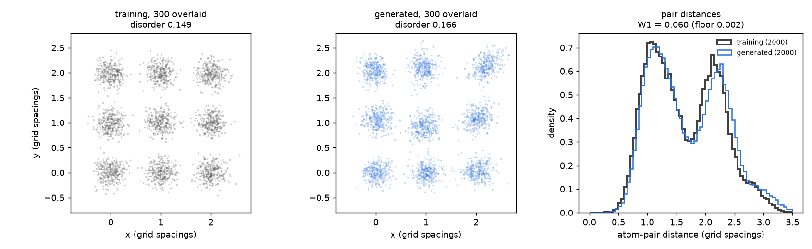

# Stage 0a: the course proof-of-concept notebook

**What:** [`notebooks/stage0_poc.ipynb`](../../../notebooks/stage0_poc.ipynb), the notebook
provided with the project. It trains small MLP denoisers on tiny 2D grids, using a DDPM with
200 steps and time as an input. It has four demos:

1. **grid:** a 3×3 grid with Gaussian jitter (sd 0.15), unconditional generation. This is the
   proposal's Fig. 1.
2. **grid_gpu:** the same with a wider MLP and jitter 0.12.
3. **frenkel:** half of the training grids have one atom moved to a square centre. Generation
   pins atom 4 at (1.5, 1.5) at every step (naive clamping).
4. **antisite:** a 2×2 two-species grid, half of it with A0 and B0 swapped. Generation pins
   the swap.

**How:** `scripts/stage0_poc.py` runs each code cell exactly as written: fresh namespace,
fixed seed, figures saved to files instead of shown, and the notebook unchanged. It runs on
a CPU; the whole set took about 14 min with 4 threads. It also measures:
- for the grid demo, over 5 seeds, what Fig. 1 reports;
- for the defect demos, whether the rest of the lattice stays intact.

```bash
python scripts/stage0_poc.py --out results/stage0/poc --seeds 0 1 2 3 4
```

Files:
- `metrics.json`: all numbers.
- `figure1_reproduction.png`: Fig. 1, seed 0.
- `grid.png`, `grid_gpu.png`, `frenkel.png`, `antisite.png`: the notebook's own figures.
- `antisite_fixed.png`: the antisite demo with the fix described in §3.



## 1. Fig. 1 reproduces

Each seed compares 2,000 training structures with 2,000 generated ones. The table gives the
mean over 5 seeds, with the range in brackets.

| | Proposal Fig. 1 | Rerun: mean (range) |
|---|---|---|
| W1 of atom-pair distances, generated vs training (grid spacings) | 0.068 | 0.063 (0.033–0.122) |
| W1 floor: training vs a fresh set from the same generator | — | 0.003 (0.001–0.004) |
| Positional disorder, training (RMS offset from the site, per coordinate) | 0.149 | 0.150 |
| Positional disorder, generated | 0.163 | 0.153 (0.131–0.166) |

- Both numbers in Fig. 1 fall inside the range over seeds. The notebook's figure and numbers
  reproduce.
- The seed-to-seed spread is large: W1 varies by 4× and generated disorder runs from too
  ordered (0.131) to too disordered (0.166).
  - The notebook trains on the full set with one random noise level per step, so it ends
    wherever the last steps leave it.
  - Its printed "final loss" (0.02–0.59) is that one step's loss and does not predict
    sample quality.
- **W1 is about 20× the floor at every seed.** The MLP learns the grid and its spread
  approximately, not exactly. This fits its role as a pipeline check.

## 2. Defect demos by naive clamping

500 generated structures per demo (seed 0), compared with the training structures that
carry the same defect. "Intact" means every unpinned atom is within 0.35 (Frenkel) or 0.3
(antisite) of its own site. For Frenkel, it also means no atom has moved into the vacancy.

| Demo | Intact, generated | Intact, training with this defect |
|---|---|---|
| Frenkel pair (atom 4 pinned at the square centre) | 0.89 | 0.97 |
| Antisite, notebook as provided | 0.88 | 1.00 |
| Antisite, fixed (§3) | 0.94 | 1.00 |

Clamping keeps the rest of the lattice in place about 9 times in 10, somewhat less often
than in the training structures. This is a pipeline check on 9 atoms, not evidence for
clamping at scale; our 2D baselines B4 (clamp) and B5 (RePaint) test that.

## 3. A bug in the antisite demo

The antisite cell builds the A sites with `np.arange`, which gives integers. The swap then
writes A0's new position (0.5, 0.5) as (0, 0).

So in every "antisite" training structure:
- A0 stays on its own site and B0 sits on top of it (mean A0–B0 distance 0.14; a real swap
  gives 0.71);
- B0's site is empty.

The model never sees the configuration that generation then pins (A0 at (0.5, 0.5), B0 at
(0, 0)). The demo's figure still looks plausible, because the pinned atoms are drawn where
they were pinned.

With float sites (one added `.astype(float)`, run as `antisite_fixed`), the training swaps
are real and the generated lattice stays intact more often (0.94 vs 0.88). The notebook in
`notebooks/` is left as provided. Our own pipeline does not use the notebook's code, so the
bug does not affect any of our results.
